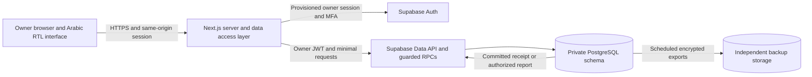

# DEQS Phase 3.0 architecture

Design proposal for one grocery store and one authorized owner in Jordan. Reviewed on 8 November 2026 against checkpoint `74d91bc9f44a57f00ab91fe2f2f8fb96dc7fba2a`. The design assumes an online connection and a hosted deployment. The owner decisions in the roadmap govern any later implementation.

The [master implementation plan](../DEQS-IMPLEMENTATION-PLAN.md) governs milestone order. See the [decision record](decisions.md) for corrections to the original design and [progress](../DEQS-PROGRESS.md) for implementation and verification status.

## Recommended system

Keep Next.js App Router as the application and add Supabase Auth and managed PostgreSQL. Use one server-only data access layer for owner checks and calls to a small set of database routines. PostgreSQL is the source of truth for posted financial entries and operation receipts. The browser handles forms, pending states and explicit recovery. A private reporting query derives balances from the ledger each time at this scale.

Use separate development/staging and production data. Staging uses synthetic customers and amounts. A single serialized write path is sufficient for one owner and simplifies concurrency, opening-balance approval and audit. Database access is server-authorized, transactions are short, and generated reports avoid mutable duplicate totals. DEQS has no offline financial queue. A network interruption pauses posting until the owner can verify or resume the same server-side command.

## Current checkpoint review

| Area | Observed at review |
| --- | --- |
| Git | `main` was clean at `74d91bc9f44a57f00ab91fe2f2f8fb96dc7fba2a`, descended from `eb43b6243319ae38620a4f894779636a93574b25`. |
| Configuration | Next.js 16.4.5 from the lockfile, App Router, strict TypeScript with the `@/*` alias, and Tailwind. Next config disables the powered-by header. |
| Routes | `/` dashboard, plus `/customers`, `/archive`, `/reports`, and `/settings` placeholders. The root layout provides Arabic/RTL and the shared app shell. |
| Components | The collapsible navigation and mobile drawer live in `AppShell`. `DebtSummary` distinguishes unavailable, masked and revealed states. The current dashboard supplies unavailable data. Fixtures exercise the available and zero states. |
| Verification | Phase 1.1 verified the welcome interface. Phase 2 verified the dashboard and navigation. Phase 2.1 recorded 88 passing production browser assertions across six viewports. The checkpoint run independently passed TypeScript, ESLint and 17 reported privacy tests, and built all five routes on Node 24.22.1. |
| Remaining scope | The existing application is an interface foundation. Owner authentication, data storage, customer operations and ledger posting are future work. |

Sources: [Project README](../../README.md), [handover snapshot](../DEQS-PROGRESS.md), [Phase 1.1 QA](../phase-1.1-qa.md), [Phase 2 QA](../phase-2-qa.md), [Phase 2.1 QA](../phase-2.1-qa.md).

## Reproducible runtime policy

Both Node 26.13.0 and Node 24.22.1 were confirmed available on the workstation. During the checkpoint, the default Turbopack production build on Node 26.13.0 failed at CSS worker startup both in and outside the sandbox. A sandboxed Webpack diagnostic hit a filesystem permission error. The unchanged production script passed with the installed Node 24.22.1 runtime. This isolates a working configuration for this workspace. The underlying Node 26 worker failure remains undiagnosed.

Milestone A pins Node **24.22.1** in `.node-version` and documents npm **11.20.0**. The existing `engines` range remains a compatibility declaration. Use the lockfile with `npm ci` and print versions when recording checks. Verify the hosting runtime can honor the pin. Review supported Node 24 security patches and promote them after a full check. [Node.js release and LTS policy](https://nodejs.org/en/about/previous-releases)

## Reading order

1. [Proposed database schema](database-schema.md) defines tables, keys, indexes, ownership and invariants.
2. [Ledger, opening balances and reports](ledger-and-reporting.md) defines money, corrections, migration and time.
3. [Transaction safety and online saves](transaction-safety.md) defines the full request lifecycle and duplicate protection.
4. [Owner authentication and data security](security.md) defines the authorization boundary and account recovery.
5. [Backups and disaster recovery](recovery.md) defines plan dependencies, targets and restore verification.
6. [Roadmap and owner decisions](roadmap.md) defines the acceptance gates, tradeoffs and Phase 3.1 boundary.
