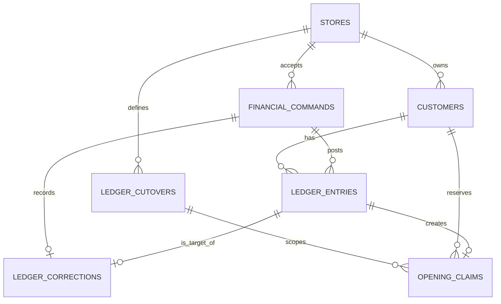

# PostgreSQL schema and planned write boundaries

The [Milestone A migrations](../../supabase/migrations) are the executable source for the foundational schema and grants. The tables and constraints below describe the design. Posting, reconciliation, recovery and other write routines remain later milestones.

## Conventions and ownership

Store tables in unexposed `deqs_data`. Use `store_id smallint` fixed to `1` to enforce a single store in this release. Use UUIDs for customer, cutover, entry, correction, operation and recovery-epoch identifiers. Primary keys and foreign keys below carry `store_id` so a future expansion cannot silently create cross-store references. Actor references use a stable owner principal ID and retain the Auth user ID that actually authorized each command. The stable principal survives a reviewed Auth rebind after recovery.

Use `timestamptz` for instants and set server/report serialization to UTC. Use `date` for named local dates such as the paper-ledger cutover day. DB-managed insertion times and actor IDs come from trusted database context. Use `bigint` for signed individual ledger deltas in fils. Set a much smaller application limit per entry than the signed 64-bit range so a reversal is representable. Review the limit with the owner. PostgreSQL `SUM(bigint)` returns exact `numeric`, so avoid downcasting aggregates without an explicit bound. Return amounts, totals and sequence numbers as decimal strings at the API boundary. [PostgreSQL numeric types](https://www.postgresql.org/docs/current/datatype-numeric.html) · [PostgreSQL aggregates](https://www.postgresql.org/docs/current/functions-aggregate.html)

## Tables and constraints

| Table | Proposed fields and rules |
| --- | --- |
| `stores` | `store_id` PK and singleton check, `owner_principal_id` UUID with `UNIQUE (store_id, owner_principal_id)`, nullable unique `owner_auth_uid`, `access_enabled`, `writes_enabled`, `write_epoch` UUID, `created_at`. Check that enabled access has an Auth binding and enabled writes imply enabled access. The binding is verified by an operator against Supabase Auth and checked against signed JWTs. Keep it separate from historical actor IDs so a portable restore can disable access and rebind safely. Only a restricted operator provisions or changes it. |
| `customers` | PK `(store_id, customer_id)`, `display_name`, normalized `name_search`, nullable `phone_normalized`, `created_at`, `updated_at`, nullable `archived_at` and `archived_by`. Require a nonblank bounded name, valid optional phone text and paired archive fields. `store_id` and the optional archive actor reference the store/principal. Names and phone numbers can be shared. They drive duplicate warnings rather than identity constraints. Archive and restore retain the ID and all references. |
| `customer_profile_events` | Append-only events for creation, edits, archive and restore, with store, customer, stable principal and Auth IDs, before/after profiles and recorded time. Customer mutation routines must append their events in the same transaction. |
| `ledger_cutovers` | PK `(store_id, cutover_id)`, `local_cutover_date`, `effective_at`, `paper_ledger_ref`, expected reviewed paper-account count and exact opening total, `state` (`draft`, `reconciling`, `closed`), `created_at`, nullable `closed_at`, closure snapshot/watermark and owner. Count accounts after grouping split source lines. Unique `(store_id, local_cutover_date)`. A partial unique key on `store_id` for draft/reconciling states permits at most one active cutover. The posting and close routines check migration mode. Closed snapshots are read-only to application writers. |
| `financial_commands` | PK `(store_id, idempotency_key)`, `write_epoch`, `kind`, `payload_version`, canonical `payload jsonb`, stable `actor_principal_id`, `actor_auth_uid`, `state` (`prepared`, `committed`, `cancelled`), `prepared_at`, nullable `terminal_at`, nullable `receipt jsonb`. FK actor to the store principal. Constrain timestamp/receipt combinations by state. A committed receipt is required and a cancellation retains its own terminal result if exposed. The original command details and terminal outcome are immutable. The journal remains available for replay checks and recovery. |
| `ledger_entries` | PK `(store_id, entry_id)`, `ledger_seq bigint` identity and unique, `command_key`, `ordinal`, `customer_id`, `economic_kind` (`opening`, `purchase`, `repayment`), `entry_role` (`original`, `reversal`, `replacement`), `delta_fils`, optional bounded note, `effective_at`, `recorded_at`. FK to command and customer. Unique `(store_id, command_key, ordinal)`. Check sign/range for originals and replacements. Reversals are checked against their targets. The command provides the owner identity and request provenance. Ledger rows are insert-only. |
| `opening_drafts` | Editable source row scoped to cutover and unique paper reference, with reviewed customer details, exact proposed fils, optional linked customer and monotonically increasing revision. Approval binds a single command to the reviewed revision and makes the draft immutable. |
| `opening_claims` | PK `(store_id, cutover_id, customer_id)`, `entry_id`, `origin_entry_id`, `claim_kind` (`source`, `transfer`), optional normalized `paper_ref`, `recorded_at`. FK to cutover, customer and entries. Unique `(store_id, entry_id)`. Require `paper_ref` only for a source claim and use a partial unique index on `(store_id, cutover_id, paper_ref)` for source claims. The source claim points to its original opening as both entry and origin. A transfer claim points to a replacement entry and retains the source origin. Claims are permanent reservations. |
| `ledger_corrections` | PK `(store_id, correction_id)`, `command_key`, `target_entry_id`, `reversal_entry_id`, optional `replacement_entry_id`, signed `previous_delta_fils` and `corrected_delta_fils` (zero for a void), required bounded `reason`, `recorded_at`. FK to command and all linked entries. Unique command, target, reversal and non-null replacement per store. Require distinct link IDs. The command identifies the authorized owner. The target/replacement chain preserves history and can be followed to the original entry. |

`opening_claims` is the uniqueness fence for posting an opening or transferring one to a different customer. A correction that changes an opening amount on the same account uses the existing claim. The source reference is reserved even after a void or transfer. Initial migration completion requires one approved source opening per included paper account, with an explicit zero for a reviewed settled row if included. A duplicate amount by itself is irrelevant.

Commands store a required SHA-256 fingerprint alongside versioned JSONB. Opening claims also link the approving command and original draft. The only Milestone A application RPC is `deqs_api.owner_context()`. Its restricted `deqs_context_reader` helper can select only the store through forced RLS for the bound owner with AAL2. The migrations seed no owner and grant no application table writes.

### Indexes beyond keys and uniqueness constraints

| Lookup | Proposed index |
| --- | --- |
| Customer selector and duplicate hints | `(store_id, archived_at, name_search, customer_id)` and partial `(store_id, phone_normalized)` for non-null phones. Use normalized prefix search initially. |
| Account statement and balance | `ledger_entries (store_id, customer_id, effective_at, ledger_seq)` with deterministic keyset paging for statements. |
| Store period reporting | `ledger_entries (store_id, effective_at, ledger_seq)`. Use the sequence key for knowledge cutoffs. |
| Recovery queue | Partial `financial_commands (store_id, prepared_at)` for `state = 'prepared'`. Committed receipts can be found by key or by `terminal_at` when needed. |
| Opening reconciliation | `opening_claims (store_id, cutover_id, origin_entry_id)` alongside the claim PK and the unique source reference. |

Do not index every JSON field. Maintain one authoritative ledger and query it directly at this store's scale. Measure statement and report plans on representative volumes before adding a projection. A later projection would need a rebuild and exact reconciliation from the same ledger.



## Which layer enforces each invariant

- **Keys and row checks:** enforce command, ordinal, claim, source and reversal uniqueness, parent existence, required fields, sign/range and state shape. Use explicit `NOT NULL` on required fields so nulls do not pass checks. FK deletion defaults to restrictive behavior. Never cascade-delete financial history.
- **Cross-row invariants:** the posting routine validates the expected number and roles of entries per command, correction linkage, negated reversal, amount equality with correction metadata, original effective date, opening claim lineage, and cutover/archival state. A deferred constraint trigger or equivalent commit-time guard in the first financial milestone must reject a committed command missing required entries or audit/claim rows, as well as ledger entries tied to an uncommitted command state. These rules cannot be expressed by ordinary row `CHECK` constraints alone. Test a forced violation that happens at commit.
- **Immutability:** grant the posting role ledger, claim and correction `INSERT` and required `SELECT` only. Prohibit row mutation/deletion and truncation in runtime privileges and add explicit update/delete guards to immutable tables. Constrain journal updates to the defined transitions. Corrections append entries. A privileged database operator can still alter a database, which is why access separation, restore drills and independent backups matter.
- **Ownership and RLS:** authorize the current bound owner with verified MFA assurance, then resolve store and actor within the routine. Use forced RLS and narrow policies for the limited runtime roles. The store ID and acting principal do not come from a writable browser field. See [security](security.md).

Example declarations to translate during implementation, with full FKs and grants still to be specified in migration code:

```sql
-- Keys on the proposed tables
PRIMARY KEY (store_id, idempotency_key)                 -- financial_commands
UNIQUE (store_id, command_key, ordinal)                -- ledger_entries
PRIMARY KEY (store_id, cutover_id, customer_id)         -- opening_claims
UNIQUE (store_id, target_entry_id)                     -- ledger_corrections

CREATE UNIQUE INDEX opening_source_once
  ON deqs_data.opening_claims (store_id, cutover_id, paper_ref)
  WHERE claim_kind = 'source';
```

Database semantics: [PostgreSQL constraints](https://www.postgresql.org/docs/current/ddl-constraints.html) · [PostgreSQL triggers](https://www.postgresql.org/docs/current/sql-createtrigger.html).
