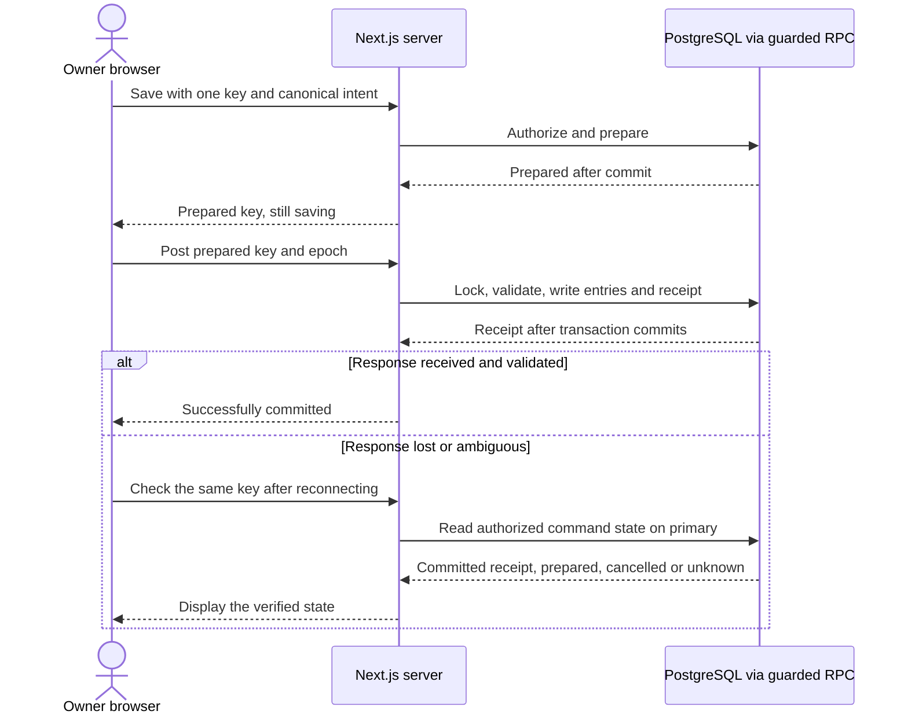

# Financial transaction safety and online saves

## Commit and durability contract

A successful financial response means PostgreSQL has committed the complete operation and its replay receipt. A UI click, local validation, transport delivery, or a successful command preparation is insufficient to show **تم الحفظ بنجاح**. Use one read-write RPC transaction for posting. Persist entries, any new customer/claim or correction, and the terminal receipt atomically. Treat a receipt returned by an RPC as committed only after the Data API confirms transaction success and the response validates against the requested command and schema. A committed status read on the primary can also confirm success. Confirm transaction-end behavior on the actual hosted configuration before enabling writes. [PostgREST transactions](https://docs.postgrest.org/en/stable/references/transactions.html)

Use WAL-backed permanent tables and synchronous commit for financial transactions, including preparation. Verify the production setting persists through the transaction boundary and confirm the platform durability configuration. The request path must commit on success with rollback override disabled. Next.js sends no client-controlled `Prefer: tx=rollback` header to the Data API. Acceptance tests must prove that direct RPC callers cannot get a success receipt from a transaction deliberately rolled back at the end. For example, test a forced deferred constraint failure in staging and check the primary for missing entries and a noncommitted command. Synchronous commit provides database durability at the configured PostgreSQL boundary. Disaster recovery still depends on replication, retained backups and tested recovery points. [PostgreSQL WAL settings](https://www.postgresql.org/docs/current/runtime-config-wal.html#GUC-SYNCHRONOUS-COMMIT)

## Identity and canonical command

- Generate one random UUID per confirmed financial intent. Capture it before any network request. Disable repeat submit while saving and guard keyboard submit and double clicks with the same in-flight key. An intentional next purchase gets a fresh key even if every detail matches.
- A key is unique per store across all financial command kinds. Canonical payload includes command kind and schema version, recovery epoch, target IDs, exact signed or positive fils strings as specified per operation, normalized optional text, effective-time mode, and required approval/reason/source fields. Validate sizes, allowed keys and semantics on the server and at the database boundary. A server-assigned posting time is an output, so retries never recalculate it as an input.
- Store a SHA-256 fingerprint of the canonical intent and compare canonical JSONB and kind/version exactly after normalization. Canonicalization rules are versioned and stable for existing commands. Full equality governs replay. Reject the same key with changed details using a conflict response. Use the verified owner identity and store context for scope. Retain terminal receipts and keys alongside ledger history.

## Request lifecycle

1. **Ready.** The owner reviews the entered intent and submits. The browser holds the intent and key while online. The authorized screen obtains the current write epoch from the server. No browser persistence of financial amounts, pending drafts or transaction queues. On reload, authorized recovery reads find server-prepared commands and recent receipts. Server-side preparation is intentional so a lost browser response does not force re-entry of uncertain data.
2. **Prepare.** A short transaction checks owner, MFA, write epoch and command shape, then records the canonical intent in `financial_commands` as `prepared`. Repeat preparation with an identical key/details returns the same state or terminal receipt. Mismatched details are rejected even for cancelled or committed keys. Preparation creates no ledger entry or customer. A failure or missing response never causes automatic posting. Verify or retry preparation with the same key if available. If it was lost on reload, refresh the pending list before creating another intent. A late preparation can leave an orphan draft, which can only post through a later explicit owner action.
3. **Post.** Send the key and epoch using the already prepared command, with no replacement financial details. Database loads the stored payload, rechecks current authority and eligibility, and locks writes as described below. A previously committed command returns its original receipt even if balances have since changed. A cancelled command returns its terminal cancellation and cannot post. For a prepared command, run the appropriate business operation, store its receipt and set state to `committed` in one transaction. Capture the before/after balances, entry IDs, exact amounts, effective and recorded times, and result version in that receipt. Never reconstruct a replay receipt from today's balance.
4. **Resolve.** A verified receipt is success. A clearly rolled-back attempt or rejected validation is failed for that attempt. The prepared command can still be retried unchanged if eligible. With concurrent attempts, reconcile the command state before offering replacement. A timeout, aborted fetch, disconnect, gateway error with unknown DB outcome, or unreadable receipt is **outcome uncertain**. Keep the current intent and recover by key or through the authenticated pending/recent list. A `prepared` or missing observation can race with a request still in flight. Neither justifies sending a new key for the same intent.
5. **Recover or abandon.** A committed result displays the stored receipt. For a prepared result, explicitly retry the same key or request cancellation. Cancellation takes the same write lock as posting and durably marks a still-prepared command `cancelled`, or returns the existing committed receipt if posting won. Only after confirmed cancellation may the owner prepare a changed replacement. Post never creates a missing command. With an uncertain preparation and a known key, retry it or fence it by durably recording a cancelled reservation with the original canonical intent under the same key, so a late prepare cannot resurrect it. If the key was lost before any posting could start, wait for the pending list to settle and cancel any orphan. If posting could have started, match recent/pending receipts and ledger entries before taking further action. No auto-submit from the recovery screen.

On an ordinary known failure, distinguish field errors, a business-state conflict, session expiration and maintenance. Reauthorize before lookup or retry, preserving the existing command. A new key always means an explicit new or safely replaced intent. The current write epoch is required for creating or posting a command. An authorized status read can return retained terminal receipts from a prior epoch during maintenance when private reads are enabled. Following restore, an unknown or prepared old-epoch key needs manual reconciliation and cannot post under the new epoch.

## Concurrency and consistency

For this single-store workload use one reserved, documented transaction-scoped advisory lock per store, acquired by all DEQS write routines. Acquire it before reading mutable state or calculating balances, including prepare, post, cancellation, archive/restore, migration close and operator mode/binding changes. Verify owner binding and current epoch again after acquiring the lock. Use read committed with separate statements after lock acquisition inside the volatile write routine, so checks see committed changes from preceding writers. Do not perform network calls or wait for owner confirmation inside a transaction. Set bounded lock/statement timeouts and treat ambiguous transport failures as uncertain. Guard state transitions and uniqueness in the database even with serialized writers. [PostgreSQL advisory locks](https://www.postgresql.org/docs/current/explicit-locking.html#ADVISORY-LOCKS) · [Read Committed](https://www.postgresql.org/docs/current/transaction-iso.html#XACT-READ-COMMITTED)

Read reports from one consistent committed snapshot. Read recovery status from the writer/primary, without shared caches or lagging replicas. The lock solves concurrency within the authorized write boundary, including posting versus cancelling, archive versus purchase, concurrent openings, and two corrections targeting one entry. A privileged operator must follow the same maintenance discipline. Unique keys stop duplicate retries of one command. They cannot identify two separately confirmed commands that happen to represent the same real-world purchase. Use confirmation, visible receipts and reconciliation for that case.

## Owner-facing save states

| State | Suggested Arabic text | Behavior |
| --- | --- | --- |
| Ready to save | `جاهز للحفظ` | Editable form, clear preview, Save enabled online when valid. |
| Validating | `جارٍ التحقق…` | Validate fields and confirmed intent, hold repeat submissions and surface actionable errors. |
| Saving | `جارٍ الحفظ…` | Lock submit and form identity, announce status politely, keep the existing key. Preparation alone stays in this state. |
| Successfully committed | `تم الحفظ بنجاح` | Show committed receipt and refreshed authoritative balance. Enable a separate new entry action. |
| Failed | `تعذّر الحفظ` | Show a precise actionable reason for a known rejection or rollback. Offer retry unchanged, or explicit cancellation before changing a prepared intent. |
| Outcome uncertain | `تعذّر تأكيد الحفظ. تحقّق من العملية.` | Offer **Check status** first, then same-key retry or safe cancellation if eligible. Do not clear the form, show success, queue an offline retry, or enable a replacement before reconciliation. |

Offline status disables financial submission and reports missing connectivity. A server-authorized check after reconnecting resolves pending work. Keep financial responses, session material and full payloads out of application logs. Use request IDs, result codes and timing for troubleshooting.

## Verification gates for later implementation

Simulate double clicks, parallel identical and conflicting payloads, two genuinely distinct equal purchases, timeouts before/after DB commit, server restart, refresh, tab/device loss, stale epoch after restore, and posting versus cancellation. Exercise failed customer creation during opening, duplicate paper references, parallel corrections and cross-customer moves with one leg forced to fail. Assert exact entry counts, receipt replay, balance reconciliation and a truthful UI state. Confirm that committed rows are immediately visible to authorized status reads and that cancelled or stale keys cannot post.
